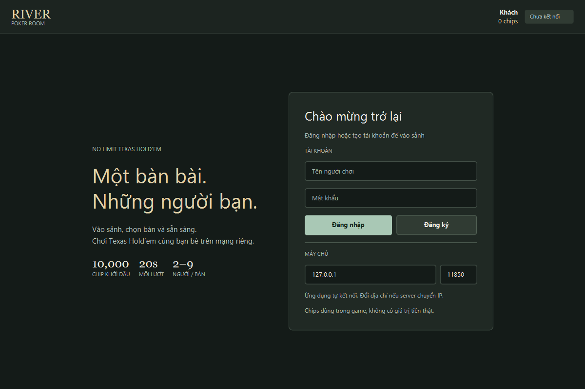
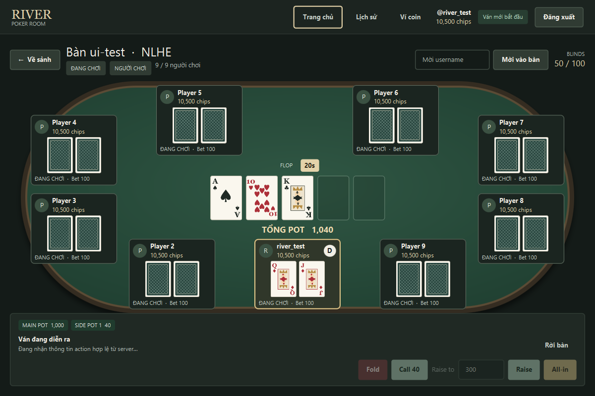
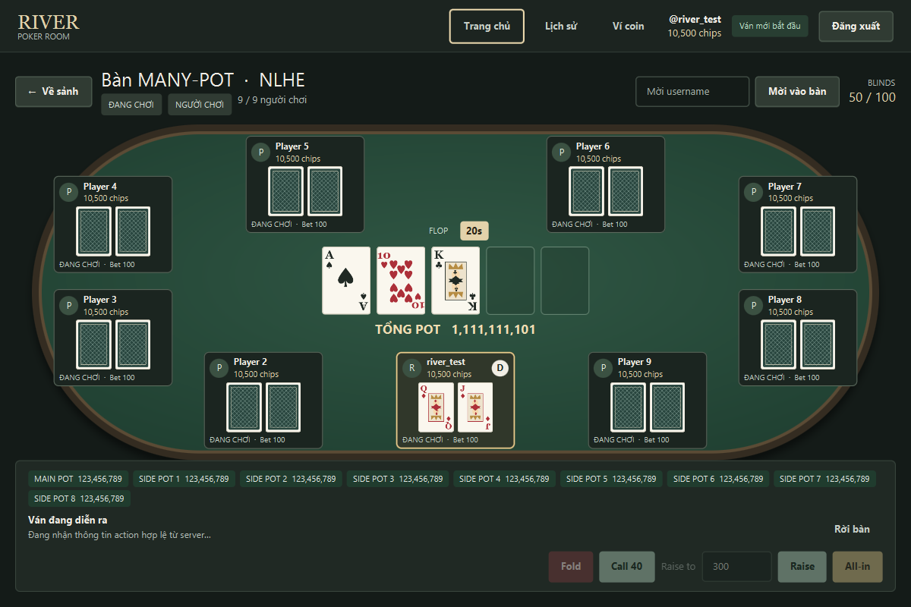
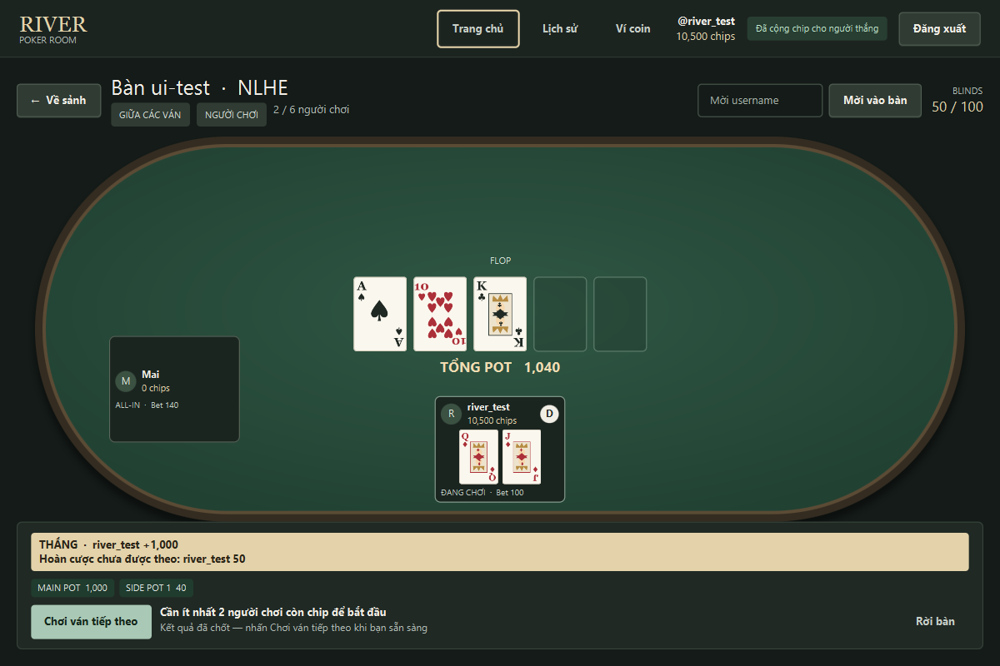
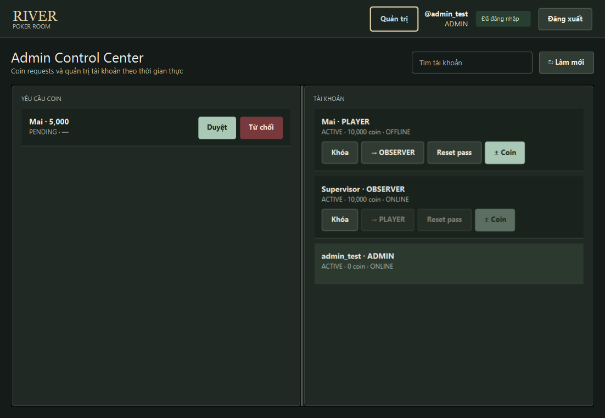
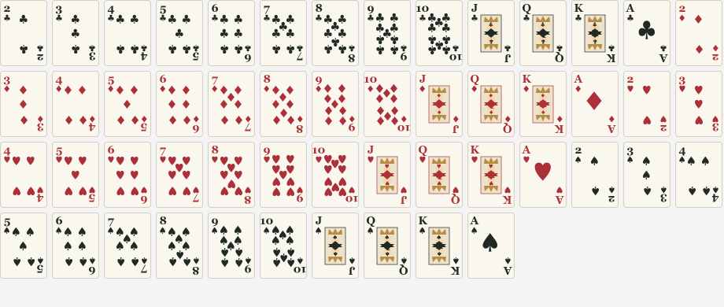

# Kết quả review Poker — 30/09/2026

Review toàn bộ source hiện tại vì repository chưa có HEAD/commit làm baseline. Không thay DB production, không thêm framework/dependency, không sửa yêu cầu Observer của đồ án. Áp dụng code-review (Standards/Spec), research, TDD, ui-ux-pro-max/JavaFX và phần phù hợp của ui-styling; không áp dụng style marketing trả về từ truy vấn chung.

## Standards: lỗi đã sửa

- Login bằng password sau disconnect không reconnect seat: login/resume dùng cùng đường attach + reconnected.
- Approval có thể commit trước JOIN nhưng JOIN dùng wallet cũ: đọc lại wallet/quyền trong shared per-user lock; auth/login/reset/lock cũng serialize bằng lock đó.
- Logout để ghost seat/session; invitation nhầm bàn/quyền; action bỏ qua table/hand ID: revoke + leave, kiểm tra caller/target và envelope đầy đủ. Password không trim ở UI/server; reset input được che.
- Synchronous socket flush có thể chặn game/heartbeat: outbound FIFO 128 + virtual writer; đầy thì disconnect. Reader admission tối đa 64, không để socket nằm chờ không có read loop. Thông báo lock có bounded final flush.
- Command queued timeout vẫn mutation sau lỗi: hủy trước khi start; nếu đã start thì trả outcome thực tế. Close giải phóng caller chờ; game-thread reentrant call không deadlock.
- Create/leave lặp giữ runtime/thread: retirement serialize với JOIN, giữ online Observer, giữ offline Observer khi còn Player để resume; empty room cuối giải phóng tài nguyên.
- Không tự xóa Observer subscription để đổi account role: còn subscription thì từ chối đổi role, giữ khả năng resume. Admin dashboard được push wallet mới sau settlement thành công; lỗi gửi dashboard không rollback một settlement đã commit.

## Spec: luật/flow đã sửa

- Timer dựa turn generation/hand/actor, không dựa global stateVersion; reconnect giữ deadline; timeout Check nếu không facing bet.
- Short ALL_IN không được bypass quyền Raise; short opening/short BB không giảm full-raise baseline dưới BB; cumulative reopening được xét riêng từng Player.
- Chia clockwise mỗi vòng một lá, burn trước flop/turn/river.
- Uncalled excess trả lại, không tính như thắng pot; folded highest bettor không làm showdown kẹt. Pot đã được call vẫn ở lại. Dead side pot do mọi eligible Player Leave dùng house rule công khai trong tài liệu nguồn, không gán là chuẩn casino.
- Ghế tái sử dụng không kế thừa bài/contribution của người cũ. Snapshot thêm handId; client bind action vào snapshot đang hiển thị.
- Tổng stacks và minimum raise có guard overflow. Regression giữ split/odd chip, settlement rollback, privacy và next-hand Ready.

Nguồn và khác biệt house rule được ghi trong [đối chiếu PokerStars/TDA/WSOP/W3C](POKER_RULES_UI_AUDIT_20260930.md). Không tuyên bố game được casino chứng nhận.

## UI đã sửa và kiểm chứng

Felt xanh trầm, charcoal ấm, bài ivory; giảm gold/glow và copy kỹ thuật, tránh font không có dấu Việt. Bộ vector đủ 52 lá có pip layouts, rank/suit góc, court face và card back, không tải artwork không rõ quyền. Player đặt ở phía dưới; 7–9 ghế có slot perimeter riêng. Kiểm tra cả cửa sổ nhỏ: ghế không chồng nhau, tổng pot không bị che và action tray còn trong viewport.

Tổng pot ở tâm bàn; mọi main/side pot nằm trong vùng riêng không bị seat che. Payout animation chạy trước khi Ready được mở; refund có nhãn riêng. Fold/Check/Call/Bet/Raise/All-in theo prompt server, không cho raising all-in khi betting chưa reopen. Lệnh socket gửi ngoài FX thread; không tự retry wager.

Giữ đủ Back/Leave và phục hồi UI khi server từ chối rời bàn. Wallet chặn submit khi có Pending, chỉ dẫn busted player rời bàn để xin coin. Admin search, wrapping actions, disabled offline-only controls và masked temporary password. Observer ẩn wallet/game controls, ghi rõ đây là giám sát thấy toàn bộ bài.

## Bằng chứng kiểm thử

| Lớp | Kết quả | Phạm vi |
|---|---|---|
| Unit | 45 pass, 0 fail/error | Domain, evaluator toàn category/wheel/kicker/tie, betting/pots, all streets, timer/queue/lifecycle, fragmentation/EOF, slow reader/concurrent framing/admission |
| MariaDB/TCP | 11 pass, 0 skip | Ledger/idempotency, coin/admin, concurrency regressions, privacy/resume, wrong envelope, hand + next Ready, 3 Player + Observer, dashboard sau payout và Observer role guard |
| UI | 1 scenario pass, nhiều assertions | FXML + socket peer, mọi action button, navigation/roles, Ready/Unready, payout/refund, failed Leave, pending coin, Admin search, 9-seat + 9-pot stress layout |

TCP case 3 Players dùng wallets `10000/3000/7000`: pot `9000 + 8000`, refund `3000`, board 5 lá, cả ClientState và MariaDB bảo toàn `20000`. Các test chỉ dùng schema `poker_test`. UI peer là fixture giao thức, không giả là backend thật; luật/settlement được test riêng qua TCP + DB thật.

`build-portable-client.ps1` đã chạy thành công sau các sửa đổi cuối. Launcher của ZIP mới tự kết nối địa chỉ mặc định `192.0.2.10:9090` và trả lời PING/PONG length-prefix với peer trên host; kiểm tra JAR không có server entrypoint/persistence/MariaDB driver. Process và listener kiểm tra đã được đóng, không thay thế việc khởi chạy server thật.

## Ảnh UI thực tế render từ fixture

## Deployment / giới hạn

- Đợt này không đổi schema; phải restart server và thay client ZIP đồng bộ vì action yêu cầu hand ID. Không để client binary cũ chạy với server mới.
- ZIP cũ được giữ tại `D:\AI project\PokerBackups\PokerClient-pre-audit-20260930.zip`; ảnh QA lưu ngoài target để Maven clean không xóa.
- Chưa nghiệm thu trên máy Windows thứ hai/no-Java qua Radmin hoặc network-loss thực tế. UI smoke xác nhận fixture trên máy host, không thay thế remote demo.
- Chưa load-test nhiều bàn/64 người chơi dài hạn; giới hạn frame/readers là hardening, không phải benchmark capacity.
- Observer thấy tất cả bài là requirement giám sát của đồ án, không phải spectator thông thường. Ready thủ công sau mỗi hand và dead-side-pot Leave là policy dự án.
- Không cam kết không còn bug: đây là các lỗi đã tái hiện/sửa và các check đã chạy. Manual 3-player/observer trên các máy khác vẫn là bước acceptance cuối.
