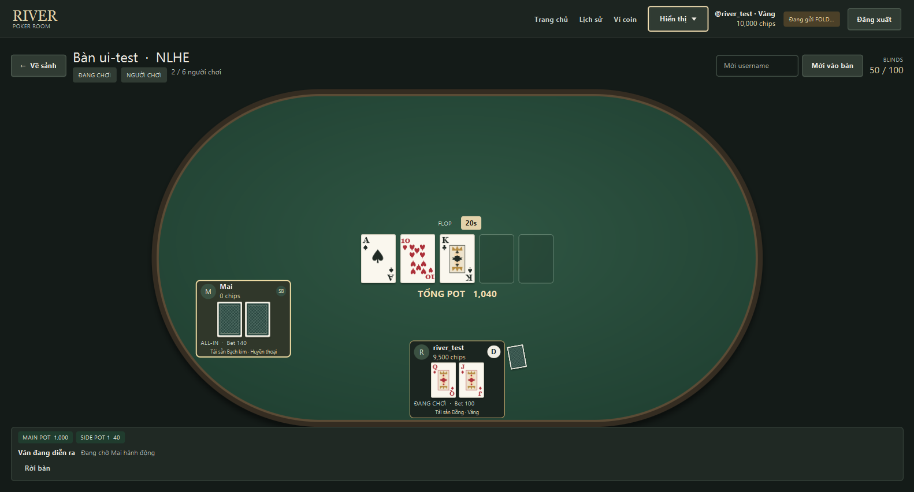
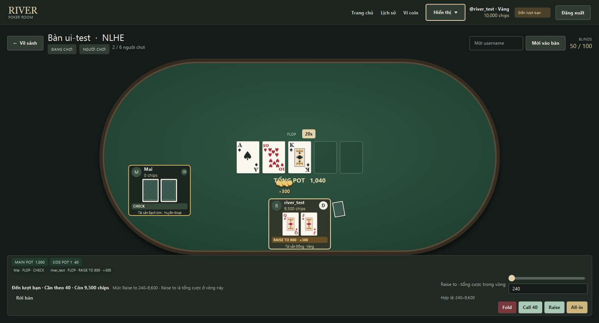
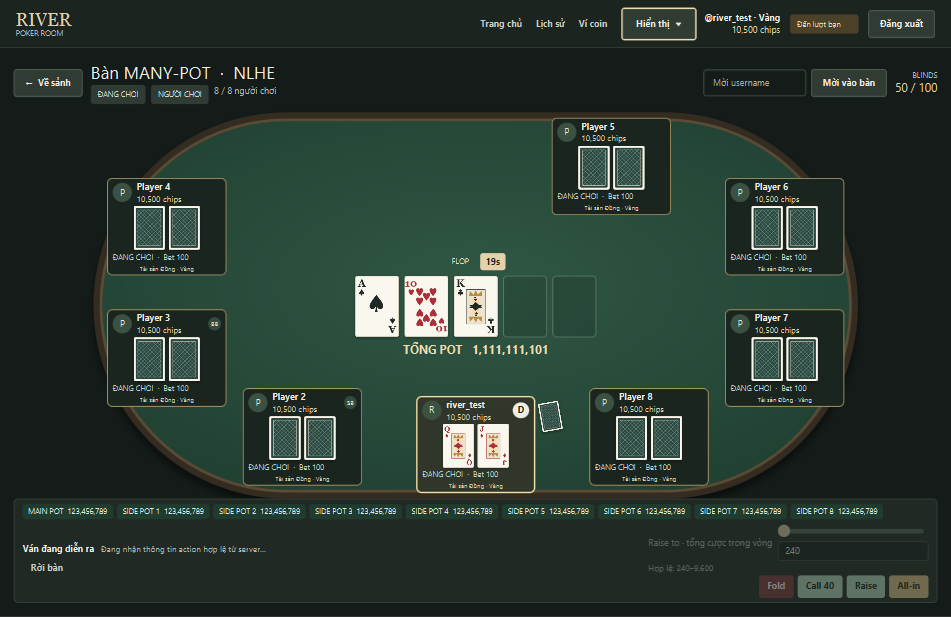

# Review và kiểm thử Poker — 11/10/2026

## Phạm vi

Đây là game Java client–server: server quyết định luật, quyền và wallet; JavaFX hiển thị snapshot và gửi yêu cầu qua TCP. Review theo tải đồ án: một server, bàn tối đa tám người và một số client trên mạng VPN tin cậy; không coi 64 reader admission là benchmark 64 người chơi.

Repository chưa có HEAD để so diff. Đã rà các luồng từ entrypoint, config/protocol, client lifecycle, authentication/session, lobby, table queue/scheduler, betting/pot/evaluator đến JDBC settlement, admin/coin và controller UI. Ưu tiên phần shared state, quyền, chip và mất kết nối; không refactor toàn bộ code, không kiểm toán từng dòng của artwork Canvas hoặc Office/portable tooling.

## Các lỗi đã tái hiện và sửa

1. **Ghế offline tồn tại vô hạn ngoài ván hoặc sau trả thưởng.**
   - Trước sửa: disconnect chỉ đổi cờ connected, ghế vẫn chiếm chỗ ở WAITING/BETWEEN_HANDS.
   - Sửa: xóa ngay ngoài hand; trong hand giữ đến settlement, rồi xóa ghế còn offline. Reconnect trước settlement giữ ghế; offline winner vẫn nhận chip.
   - Nếu bỏ qua: bàn đầy bởi người đã thoát và tài khoản bị chặn vào bàn/xin coin.
   - Kiểm chứng: `disconnectedPlayerOutsideHandReleasesSeatAndEmptyRoom`, `offlineSeatsAreRemovedOnlyAfterSettlementAndReconnectKeepsSeat`, `everyPlayerDisconnectingStillSettlesOnceAndFreesAllSeats`, TCP `offlineWinnerIsCreditedAndResumeAfterSettlementDoesNotRestoreAGhostSeat`.

2. **Bàn rỗng hoặc callback disconnect bị bỏ lỡ không được dọn.**
   - Trước sửa: runtime cuối ván có thể tồn tại nếu không có lệnh lobby tiếp theo; registry đã detach nhưng ghế vẫn connected nếu callback lỗi.
   - Sửa: heartbeat đối soát player membership với connection registry, rồi retire bàn không còn seat/Observer. Disconnect lặp là no-op khi state đã đúng; không lấy per-user lock bên trong registry monitor.
   - Nếu bỏ qua: rò game thread/scheduler hoặc để lại ghost membership.
   - Kiểm chứng: `lastOfflineHandDoesNotLeakItsRoomAfterMaintenance`, `maintenanceRepairsAMissedDisconnectCallbackWithoutRemovingAnOnlineSeat`.

3. **Socket cũ vẫn có thể Ready/Leave sau khi socket mới đã attach.**
   - Trước sửa: controller tin userId đã authenticate trên handler, không đối chiếu handler hiện hành trong registry.
   - Sửa: kiểm tra connection identity và serialize player commands với login/resume bằng per-user operation lock. Admin action vẫn chỉ lấy target lock, không thêm cặp lock Admin→target.
   - Nếu bỏ qua: command đã đọc trên socket cũ thay đổi ghế đang được socket mới sử dụng.
   - Kiểm chứng: `replacedConnectionCannotReadyOrLeaveTheNewConnectionsSeat` kiểm tra cả old disconnect callback; TCP login/reset/coin-join race tiếp tục pass.

4. **Receiver cũ đọc nhầm connection mới khi tái sử dụng PokerClient.**
   - Trước sửa: receive loop dùng field connection có thể bị thay giữa hai lần connect; hai receiver có thể đọc cùng socket mới.
   - Sửa: receiver giữ connection riêng; chỉ cập nhật state/connected flag khi vẫn là connection hiện hành, luôn đóng socket của mình.
   - Nếu bỏ qua: mất frame, lỗi resume hoặc mất kết nối mới khi receiver cũ thoát.
   - Kiểm chứng: `oldReceiverCannotCloseAReplacementConnectionOnTheSameClient` giữ callback cũ bằng latch, reconnect, giải phóng callback và kiểm tra PING/PONG trên socket mới.

5. **Frame JSON null đi qua codec.**
   - Trước sửa: Jackson trả null dù length-prefix hợp lệ; dispatcher nhận null thay vì lỗi protocol.
   - Sửa: từ chối trước khi chuyển message cho controller/client.
   - Nếu bỏ qua: disconnect/error khó phân biệt với lỗi nghiệp vụ.
   - Kiểm chứng: `rejectsJsonNullInsteadOfPassingANullMessageToTheDispatcher`; partial frame, frame limit, malformed JSON và EOF vẫn pass.

6. **Fold do rời bàn không nằm trong lịch sử settlement.**
   - Trước sửa: TABLE_ACTION báo Fold nhưng `HandSettlement.actions` thiếu bản ghi tương ứng.
   - Sửa: ghi automatic Fold tại cùng nhánh leave, với sequence/street/user và paid=0; không ghi lại nếu đã Fold.
   - Nếu bỏ qua: người xem thấy hành động nhưng lịch sử database không phản ánh đủ ván.
   - Kiểm chứng: mở rộng `leavingDuringDealSettlesOnceAndInvalidatesOldDealCallback`; trước sửa actions rỗng, sau sửa có đúng một Fold và callback cũ không settlement lần hai.

7. **CLI in session token trong LOGIN_SUCCESS.**
   - Trước sửa: listener in nguyên payload của mọi event.
   - Sửa: tạo bản sao payload để bỏ sessionId/password/temporaryPassword khỏi output; giữ username/chips và không sửa data dùng cho session.
   - Nếu bỏ qua: token xuất hiện trong console transcript được chia sẻ.
   - Kiểm chứng: `consoleOmitsCredentialsWithoutChangingTheReceivedPayload`.

8. **Thanh dưới bàn chiếm quá nhiều chiều cao.**
   - Trước sửa: trạng thái và cược xếp nhiều tầng; controls cược còn hiển thị khi không được action.
   - Sửa: status cạnh nhau, status/cược hai cột, giảm padding và chiều cao nút; slider/input giữ giới hạn 220 logical px. Không giảm font để ép nhỏ; pot/history/winner/Ready/Leave được giữ.
   - Nếu bỏ qua: ít chỗ cho ghế/bài, nhất là trên màn hình nhỏ hoặc DPI cao.
   - Kiểm chứng: UiSmokeIT kiểm tra action tray ≤170 logical px khi cược, ≤110 khi chờ lượt trong fixture; controls chờ lượt bị ẩn. Kiểm tra viewport, slider/input, các nút và tám ghế không chồng nhau ở nhiều kích thước.

## Luồng và trường hợp kiểm thử

| Luồng | Các trường hợp được kiểm chứng |
|---|---|
| Đăng nhập/client | Tự connect; password giữ khoảng trắng; login/resume; socket bị thay thế; receiver cleanup không đóng socket mới; CLI không in token |
| Lobby/quyền | Tạo/join, tối đa tám ghế, từ chối người thứ chín; Ready/Unready; Player/Admin/Observer; invitation guard; một player seat |
| Pha và lượt | DEALING không action/timer; đủ timer mới sau chia; bàn 2/3/8 người; D/SB/BB; preflop/postflop; callback cũ; leave/disconnect |
| Action | Fold/Check/Call/Bet/Raise/All-in; wrong turn/table/hand; stale version; invalid/overflow amount; short/cumulative all-in và reopen |
| Pot và kết quả | All-in runout qua từng street; main/side pot, folded contributor, tie/odd chip, refund; payout; next-hand Ready; settlement lỗi/idempotency |
| Mất kết nối | Ngoài hand; trong DEALING/BETTING; timeout; reconnect giữ hand/deadline; toàn bàn offline; offline winner; resume sau hand không có ghế cũ; missed callback |
| Coin/Admin/JDBC | Pending request/approve, exact amount, duplicate approval, join-approval race; role restrictions; reset-login race; lock/session revocation; ledger và rollback |
| UI | Login/Home/History/Wallet/Admin/Observer; tất cả action buttons, input/slider đồng bộ, rejection recovery, pot/log/badge, payout và motion settings; resize/fullscreen/minimize vẫn heartbeat |
| TCP transport | Length-prefix fragmentation/sticky frames/EOF/malformed/null/oversize; concurrent write và slow-reader/admission checks |

Test có seed `20261011` chạy 60 hand với 2–8 người, stack khác nhau, phối hợp Fold/Check/Call/All-in và action stale. Mỗi hand bảo toàn chip, không balance âm, không mutation khi reject và chỉ settlement một lần. Deck fixture cố định và input có seed giúp tái hiện lỗi; không thay thế mọi tổ hợp bài/luật hoặc load test.

## Kết quả và bằng chứng

- `mvnw.cmd -q -Pdb-it verify`: **74 unit + 12 integration tests pass**, 0 failure/error/skip; đồng thời build JAR thành công. Integration gồm 10 TCP server tests và 2 JDBC tests, chạy MariaDB thật trên schema riêng `poker_test`.
- **UiSmokeIT pass tại 100/125/150/175/200%**, mỗi mức một scenario headful với nhiều assertion; 0 failure/error/skip. Vòng chạy cuối đã qua cả kiểm tra status/Leave trong viewport khi chờ lượt.
- XML riêng từng profile tại `target/review-qa-20261011/unit/`, `db/` và `ui-{100,125,150,175,200}/`. Không cộng XML UiSmokeIT còn sót trong Failsafe vào số integration database.
- UI smoke dùng JavaFX thật và TCP fixture, không phải backend game thật. Các kịch bản luật và ledger được kiểm tra riêng qua server TCP + MariaDB. Test buộc `glass.win.uiScale` và đối chiếu outputScale thực, không chỉ resize cửa sổ để giả DPI.
- Ảnh fixture nằm tại `target/ui-smoke/review-20261011-final-{100,125,150,175,200}/`; bản chọn lọc lưu trong `docs/screenshots/review-20261011/` để không mất khi Maven clean. Không dùng ảnh làm bằng chứng nghiệm thu máy thứ hai.
- Test lỗi được chạy trước fix cho ghost seat/missed callback, stale handler, receiver reuse, JSON null, thiếu Fold history và CLI token. UI test ban đầu phát hiện tray còn 118 logical px khi chờ lượt; sửa bố cục trạng thái hai nhãn cạnh nhau, không nới ngưỡng test. Khoảng cách slider/input giữ đủ để không đè bounds.
- Khi lặp UI test, đã sửa điều kiện chờ trong fixture: disabled có thể do action pending trước khi snapshot đến; cần chờ bettingBox thực sự ẩn. Bounds chỉ xét controls đang render, không xét wager buttons nằm trong parent đã ẩn. Chạy lại toàn bộ năm mức DPI sau sửa fixture.

Lệnh tái kiểm tra (PowerShell tại repository, database test phải sẵn sàng):

```powershell
$env:POKER_DB_TEST_URL='jdbc:mariadb://127.0.0.1:3306/poker_test'
.\mvnw.cmd -q -Pdb-it verify
.\mvnw.cmd -q -Pui-it test-compile failsafe:integration-test failsafe:verify '-DargLine=-Dglass.win.uiScale=1.0' '-Dpoker.ui.screenshotDir=target/ui-smoke/review-repeat-100'
```

Các mức còn lại đổi `glass.win.uiScale` thành 1.25/1.5/1.75/2.0 và dùng screenshot directory riêng. Không dùng schema production cho integration tests.

Ảnh chọn lọc (fixture, không chứa credentials):







## Vận hành và phần chưa kiểm chứng

- Không đổi schema/dependency, production data, firewall hoặc Radmin; không restart server production. MariaDB được bật theo cấu hình XAMPP hiện có và chỉ listen 127.0.0.1:3306. Các server/clients tự khởi chạy bởi test đã được đóng.
- Chỉ build/test JAR; **không tạo portable ZIP và không sửa báo cáo Word**. ZIP 08/10 chưa có sửa đổi 11/10. Chạy server/client cùng source mới; không cập nhật server đang có hand.
- Chưa test máy thứ hai qua Radmin, ngắt adapter VPN/cáp mạng thật, Windows sạch không Java hoặc load/soak nhiều bàn dài hạn. Heartbeat hiện có vẫn dùng chu kỳ 10 giây và ngưỡng PONG 30 giây; lỗi mạng không tạo EOF ngay không được coi là disconnect tức thì.
- Chưa fault-inject DB treo lâu/mất điện giữa transaction. JDBC I/O chạy trong table queue; DB chậm có thể làm bàn chờ. Không thêm async settlement chỉ để thay đổi kiến trúc trong đợt sửa này.
- Hand đang chạy vẫn ở memory; server crash không khôi phục hand. TCP chưa có TLS riêng, chỉ phù hợp phạm vi VPN tin cậy đã cấu hình. Không mở Internet công khai.

**Kết luận:** Các lỗi tái hiện trong đợt này đã có regression test và đã sửa. Không có failure/error/skip trong các bộ kiểm thử đã nêu; đây không phải cam kết không còn bug hay nghiệm thu từ xa.

Nguyên tắc bố cục dùng JavaFX 21: [HBox layout](https://openjfx.io/javadoc/21/javafx.graphics/javafx/scene/layout/HBox.html) và [Labeled wrapping](https://openjfx.io/javadoc/21/javafx.controls/javafx/scene/control/Labeled.html).
